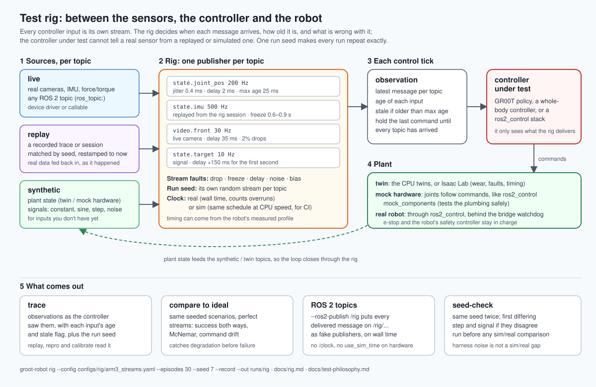

# Test rig and run seeds

The rig feeds the controller under test from many publishers at once. Each one has its own rate, timing and
data source, on the real clock or a simulated one. Run seeds make every run repeatable.



## The rig

Every input the controller reads is a **topic**: an observation key such as `state.joint_pos` or
`video.front`, with its own publisher.

| Per topic | Meaning |
|---|---|
| `rate_hz` | publish rate |
| `jitter_ms`, `delay_ms` | timing and transport delay. Same format as timing profiles: a number, `{kind: normal, mean, std}`, or measured quantiles. |
| `drop_rate` | share of messages lost |
| `max_age_ms` | older than this at a control tick counts as stale (default: 3 periods) |
| `source` | where the data comes from (below) |

| Source | Data |
|---|---|
| `plant` (or `twin`) | the plant's current value: the twin env, or `mock` hardware that follows position commands like ros2_control's mock components |
| `replay` | a recorded trace's value at the same time since the episode start, matched by seed, restamped to now |
| `signal` | constant, sine, step or noise |
| `live` | a real device or any callable. `fn: module:function`, `device: 0` for a camera through OpenCV, or `ros_topic: /camera/image` with `msg_type: image` for a ROS 2 topic |

Live, replayed and synthetic topics mix freely. For example:

- real cameras;
- a replayed IMU;
- a simulated force/torque sensor;
- joint states from the plant.

**Stream faults** hit one topic in a time window:

| Fault | Effect |
|---|---|
| `drop` | messages are lost |
| `freeze` | messages keep arriving with fresh timestamps but the same value |
| `delay` | messages arrive `severity` ms late |
| `noise` | Gaussian noise with std `severity` |
| `bias` | `severity` is added to the value |

A frozen sensor is not stale, because its messages are fresh. Staleness checks can't catch it, which is why
`freeze` is tested separately.

At each control tick the rig does three things:

1. It assembles the observation from each topic's latest message, recording how old the message is
   (`rig.age_ms.<topic>`) and whether it is stale.
2. It calls the policy.
3. It sends the command to the plant.

Before a topic's first message arrives, the rig holds the last command, or sends zeros if there is none yet.
`--record` writes the observations **as the controller saw them**.

```bash
groot-robot rig --config configs/rig/arm3_streams.yaml --episodes 30 --seed 7 --record --out runs/rig
```

The rig always runs the same seeded scenarios twice, with the rig's streams and with ideal streams. It
reports:

- success both ways, with intervals;
- a paired McNemar test;
- how far the commands drifted from the ideal run;
- per topic: published, dropped, stale ticks and maximum age.

With `configs/rig/arm3_streams.yaml`, the arm controller kept 30/30 successes, but its commands drifted by RMS
0.23. That is a degraded controller that has not failed yet, which success rates alone would hide.

### Real time and ROS 2

| Setting | What happens |
|---|---|
| `clock: sim` | Runs the exact event schedule as fast as the CPU allows. Use for CI. |
| `clock: real` | Paces every publisher and the control loop on the monotonic clock, and reports control-tick overruns and worst lateness. |
| `--ros2-publish /rig` | Also publishes each message on ROS 2 as it is delivered: `Float64MultiArray` for `state.*`, `sensor_msgs/Image` for `video.*`, stamped with the sample's wall time. |

With `--ros2-publish`, a controller under test, such as a ros2_control stack on mock or real hardware, can
subscribe to the rig's topics instead of the drivers'. When anything drives real hardware, don't publish
`/clock` or set `use_sim_time`: the rig runs on wall time.

## Run seeds

One integer **run seed** drives every random source through named streams:

- `scenario`, `wear_unit`, `faults`, `latency`, `sensor_noise`, `scheduler`, `treadmill`, `rig`;
- or any new stream name.

Each stream's seed is a hash of (run seed, name, keys). So drawing more from one stream, or adding a new
one, does not change the others. Scenario `i` also keeps its seed when a run grows from 10 episodes to 100.

The seed is written into every trace episode (`run_seed`: value, episode, and each stream's derived seed).
`RunSeed.from_trace(trace)` reads it back, so a replay, repro or calibration of a recording draws exactly what
the original run drew.

```bash
groot-robot seed-check --env arm3 --policy arm-ik --episodes 10 --seed 0 --out runs/seed
groot-robot seed-check --env treadmill --policy walker-capture --treadmill configs/treadmill/trip_ladder.yaml --out runs/seed_tm
groot-robot seed-check --rig configs/rig/arm3_streams.yaml --out runs/seed_rig
```

`seed-check` runs the seed twice and compares fingerprints: hashes of the states, actions and outcomes, with
wall-clock latency left out. If the runs differ, it reports the first differing step and signal in each
episode, and exits 1.

Run it in CI and before any sim/real comparison. A difference that also appears between two sim runs of the
same seed is noise in the harness, not a sim/real gap. Example: a controller that draws from an unseeded
random generator is caught at step 0.

## Limits

- **ROS 2:** the ROS 2 publisher and live source are written against rclpy but have not been run against a ROS
  graph here. Their message payloads are unit-tested; robot-specific lines are marked `VERIFY`.
- **Rates:** Python paces publishers well up to a few hundred Hz. A 1 kHz joint loop belongs inside
  ros2_control, with the rig feeding it.
- **Plant timing:** the plant steps at the control rate. Publishers faster than the control rate repeat the
  latest plant value, as a driver reading a slower bus would.
- **Seeds:** they cover grooteval's random sources. A policy or simulator with its own unseeded randomness
  still varies, and `seed-check` is how you find that out.
